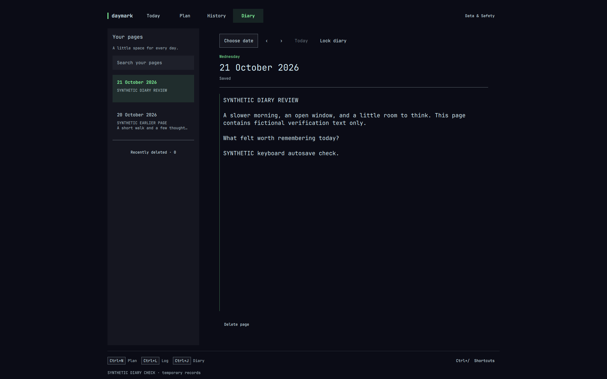

# Daymark

A small, local-first planner and journal for Omarchy. **Plan a little. Record what happened. Keep what matters.**

Current scope: planning, untimed activity logs, a standalone password-locked **Diary**, date-independent pinned activities, simple activity insights, keyboard access and **Data & Safety** with Import/Export. No timers, duration fields, complex reports or category/project management. Existing historical data is preserved.

**1.0.0-rc.1 · `naolselemon.daymark` · Naol Selemon (GitHub: `naolselemon`) · [MIT](LICENSE).** This release candidate includes the native Omarchy notebook-icon launcher, panel and shared service. Installed lifecycle checks have been completed with isolated synthetic records. Source is maintained in the private [naolselemon/daymark repository](https://github.com/naolselemon/daymark); no public release or marketplace listing has been published.

**Unreleased development changes:** the fourth Diary tab, system-password privacy lock, refined writing layout and automatic date-label rollover. The original baseline remains available at the `v1.0.0-rc.1` tag. System-password entry requires the native Omarchy plugin, not the standalone development preview.



This branch's preview is a real **1440×1000 native workspace item-tree capture** from a temporary plugin with isolated synthetic records. The item was resized inside the native window; this is not a mockup, a physical window-size certification or a capture of the normal journal. See [verification](#verification-and-review-gate) for evidence boundaries.

## Compatibility and dependencies

Tested together on this Linux x86-64 installation; these are **observed versions, not minimum requirements or a compatibility promise for other releases**:

| Component | Tested package version |
| --- | --- |
| Omarchy | `4.0.5-1` |
| Quickshell | `0.3.2.r7.g2b4501a-1` |
| Qt base | `6.12.0-3` |
| Qt declarative | `6.12.0-1` |
| Python | `3.14.8-1` |

Runtime requires the existing Omarchy shell, its built-in bar/service contract, Qt Quick / Controls / Dialogs, and Python with standard-library SQLite. No third-party Python module, extra daemon, web server, account or additional Quickshell process is required. The standalone development preview additionally needs a C++ compiler, `pkg-config` and Qt development tools; these are not installed-plugin runtime dependencies. The shell's existing plugin CLI utilities are used below; do not install packages just to follow this guide without reviewing your environment.

Diary authentication additionally uses Quickshell's built-in `Quickshell.Services.Pam` module and the existing `/etc/pam.d/omarchy-lock-password` policy. No PAM configuration is created or modified. An unavailable policy/module or an unsupported conversation cannot unlock the diary. The plain Qt development host cannot load Quickshell's statically linked PAM module: Diary and Import/Export stay locked there; use an explicitly authorized, isolated native plugin for those workflows.

Replacement bars do not expose the same trusted shared-service contract: Daymark's bar control is unsupported/disabled there. Physical multi-monitor behavior has not been verified. The installed theme test verified shell palette and typography propagation with the same workspace and unsaved draft retained, not every full-desktop theme-switch side effect.

The [MIT license](LICENSE) covers this project's source, copyright Naol Selemon. Omarchy, Quickshell and Qt are external dependencies with their own licenses; this package does not relicense them.

### API and integration references

- [Omarchy plugin development guide](https://plugins.omarchy.org/develop.html): native plugin structure, manifest validation and lifecycle. Daymark declares separate bar-widget, panel and service entry points.
- [Official Omarchy shell contract](https://github.com/omacom/omarchy/blob/quattro/shell/README.md): shared shell process, scoped plugin interfaces, theme tokens and lifecycle. This online branch is not proof of the installed version; the tested installation's shell sources and plugin CLI take precedence for the behavior documented here.
- [Quickshell Process API](https://quickshell.org/docs/v0.3.1/types/Quickshell.Io/Process/): asynchronous child processes, argument lists, standard input/output and lifecycle.
- [Quickshell PAM implementation at the tested revision](https://github.com/quickshell-mirror/quickshell/tree/2b4501a/src/services/pam): native authentication context, current-account resolution and worker lifecycle.
- [Python SQLite API](https://docs.python.org/3/library/sqlite3.html): transactions, parameterized queries and consistent database backups with `Connection.backup`.
- [XDG Base Directory Specification](https://specifications.freedesktop.org/basedir/latest/): user data, configuration and cache locations and fallbacks.

The Omarchy development and publication references were rechecked on 2026-10-20; the other API references were consulted on 2026-10-16. Consult documentation matching the installed runtime; linked current or versioned documentation does not establish broader compatibility.

## Install this local release candidate

Plugins run **unsandboxed inside your desktop shell**. Review the source before enabling. The private GitHub repository preserves the development source; access requires repository permission. The current daily-use installation is a **manual, non-Git copy**, and the instructions below retain that installation route. A source checkout does not turn the installed copy into a Git-managed plugin.

From this source directory, the following Bash commands validate and copy only the runtime trees and release documents. They refuse to overwrite an existing installation and exclude generated Python bytecode; no backend `__pycache__` directory should be shipped. The installed CLI uses `$HOME/.config/omarchy/plugins` even if `XDG_CONFIG_HOME` is set.

```bash
(
  set -euo pipefail
  umask 077
  omarchy plugin validate .
  target="$HOME/.config/omarchy/plugins/naolselemon.daymark"
  mkdir -p "$HOME/.config/omarchy/plugins"
  mkdir "$target"
  tar --exclude='__pycache__' --exclude='*.pyc' --exclude='*.pyo' \
    -cf - manifest.json LICENSE README.md preview.png \
    backend prototype integration | tar -xf - -C "$target"
  omarchy plugin validate "$target"
)
```

If copying or validation fails, stop and inspect the reported error; do not enable a partial installation. When ready to change the live desktop:

```bash
omarchy-shell shell rescanPlugins
omarchy-shell shell listPlugins
```

Rescanning is asynchronous. Wait until `naolselemon.daymark` appears in the returned catalog, then enable it:

```bash
omarchy plugin enable naolselemon.daymark
```

The notebook icon starts in the bar's right section. Its artwork follows the native icon-font size, keeping the standard clickable slot unchanged. It uses the theme foreground normally and accent on hover or while the journal is open; the native tooltip identifies Daymark. Keyboard focus has a visible outline, with Space/Enter activation when the bar receives focus. No global keyboard binding is added.

Click the notebook to open/close the journal. It uses one shared store/window rather than starting a second shell. You can also open the panel directly:

```bash
omarchy-shell shell summon naolselemon.daymark '{}'
```

Commands returning over IPC do not mean asynchronous panel creation or data loading has already finished. Wait for the visible workspace to settle.

## Disable, remove and update safely

**Before any lifecycle operation:** save or explicitly discard changed forms, wait for the diary's **Saved** acknowledgement, close the journal and export a fresh JSON backup outside the plugin source/data directory. Busy/dirty guards protect ordinary UI closing; host hide, disable, source reload, restart or process termination can unload the service without honoring a veto. Uncommitted drafts are not restart-safe.

To disable, then later re-enable:

```bash
omarchy plugin disable naolselemon.daymark
omarchy plugin enable naolselemon.daymark
```

Disable removes the widget from the active layout and unloads the service; it does not erase saved journal records. To remove the installed code, run this interactively and review its confirmation:

```bash
omarchy plugin remove naolselemon.daymark
```

On the tested CLI, removal of this **non-Git** installation moves its code folder to a hidden timestamped backup such as `~/.config/omarchy/plugins/.naolselemon.daymark.bak.<timestamp>` and rescans the shell. A Git installation is deleted instead. Neither route deletes the external `daylog` data directory or exported backups. A code-folder backup is not a journal backup.

For a later **manually installed** revision, retain the old source and a fresh journal export, disable Daymark, remove the old installation through the command above, then repeat the copy/validation instructions with the reviewed new source. This applies even when the source comes from the private Git repository. Do not overlay old and new runtime trees or copy generated caches. After successful validation, rescan, **restart the shell**, and only then enable:

```bash
omarchy-shell shell rescanPlugins
omarchy restart shell
omarchy plugin enable naolselemon.daymark
```

Restart affects the desktop, not just Daymark; do it only when you are ready. On the tested host, hot updates left old QML cached and a newly added QML file was not discoverable until restart. No seamless hot-update guarantee is made.

Only for a **separately Git-installed copy with a reviewed upstream and working repository access**, the normal targeted update sequence is:

```bash
# First save/discard, export a backup, and close the journal.
omarchy plugin disable naolselemon.daymark
omarchy plugin update naolselemon.daymark
# Review the diff/prompt and continue only after a successful update.
omarchy restart shell
omarchy plugin enable naolselemon.daymark
```

The installed updater fetches the upstream, shows a diff for confirmation, fast-forwards and validates the manifest. A bare `omarchy plugin update` targets all Git-managed plugins; it is not needed here. The local copy above cannot be updated with this command. There is no automatic-update guarantee. Before any future incompatible schema change, require tested migration/recovery instructions and backups; do not open a newer database with older code as an improvised rollback.

## Try the native development UI safely

From the repository, with the desktop awake:

```bash
# Clearly synthetic records in a disposable profile
python tools/preview.py --demo

# Wide layout with side insights; maximize/widen if your window manager tiles it
python tools/preview.py --demo --size 1440x900

# Empty disposable journal
python tools/preview.py --temporary

# Light theme, larger type; does not change the desktop theme
python tools/preview.py --demo --theme catppuccin-latte --size 700x600 --scale 1.25

# Real SQLite write failures with retained drafts
python tools/preview.py --demo --read-only
```

The launcher builds a small development Qt host in a temporary directory. No package installation, HTTP server, daemon, additional Quickshell shell or desktop configuration change. A development launcher window reopens the workspace or quits the preview. Closing the workspace preserves its in-memory drafts; guarded Quit waits for saves or explicit discard.

The default `--theme current` now follows Omarchy theme changes while the window is open, including palette and font/spacing tokens. Updates do not recreate the workspace or discard drafts. Incomplete theme writes retain the last valid palette and report a diagnostic. Explicit `--theme catppuccin` / `catppuccin-latte` previews intentionally stay fixed. Nothing here changes the desktop theme.

## Everyday use

- **Today:** check your list and log what happened. Open Diary takes you to today's private page; no diary text appears in Today.
- **Plan:** add a title, date and optional note. No date puts it in Inbox. Click a title to read/edit it; the checkbox marks it done.
- **History:** search and browse activity entries and completions. Diary text and deleted diary pages are excluded.
- **Diary:** unlock with your Linux account password, then write on a softly surfaced page with a comfortable line width. Your pages groups dated excerpts by month, with text/date search and Older/Newer navigation. Smaller windows use **Pages** / **Back to writing**. The selected-date calendar, day arrows, Lock and save status stay visible while writing scrolls. Choose Today inside the calendar or use Ctrl+J; Diary date selection remains independent of Today.
- **Log activity:** create a new activity or select an existing one. Optionally mark it done. Logging never implies completion or duplicates an existing activity.
- **Data & Safety:** directly in the header, containing Export journal and Import a backup.
- **Pin activity:** open an activity and choose Pin activity. Pinned quick-access cards appear in Today and Plan on every date, with a Log action for the same activity. Unpin from its detail. Completion keeps the pin; deletion hides it and Undo restores it. Pinning never changes a planned date or creates recurring copies.

Existing daily notes already appear in Diary; there is no migration, copied notebook or second note format. Recently deleted diary pages and their Restore action live inside the unlocked Diary.

**Dates update automatically:** Today/Yesterday/Tomorrow references follow the computer's local calendar within one minute, including after an overnight sleep or clock adjustment. An open diary page and selected activity date stay on their original dates; drafts are not moved, cleared or silently saved. Use **Ctrl+J** or the calendar's Today action to write on the new day. The lightweight clock check does not call the storage helper unless the date changes.

### Diary privacy lock

The password is checked through the installed Omarchy password PAM policy for the process's current Linux account. Daymark does not save it, send it to the Python helper, or accept a separate app password. Authentication errors, cancelled requests and passwordless success fail closed.

The diary starts locked and relocks when you leave its tab, the journal loses focus, or the window is hidden/closed. Use **Lock** or **Ctrl+Shift+L** to lock immediately. The private editor is removed while locked. Pending notes are flushed; failed drafts remain in memory behind the lock and still prevent ordinary closing until saved or explicitly discarded.

**This is a privacy lock, not encryption.** SQLite, recovery backups and exported JSON remain plaintext. Someone with access to your account/files can read them outside Daymark; the backend and developer tools are not password-protected storage APIs. It does not promise secure memory erasure. Import/Export requires the same authorization because archives can contain diary text; switching away from a file chooser may require unlocking again.

**Password field has no cursor in the development preview?** That host has no native PAM provider, so its password field is deliberately disabled—not rejecting your password. Open the updated Daymark from the Omarchy notebook icon and choose Diary → Unlock diary. Updating the source checkout alone does not update the separately installed plugin; follow the approved installation/update procedure above.

### Keyboard shortcuts

The footer shows **Ctrl+S Save**, **Ctrl+F Find**, and **Ctrl+Shift+L Lock** while Diary is unlocked; elsewhere it shows **Ctrl+N Plan**, **Ctrl+L Log**, and **Ctrl+J Diary**. **Ctrl+/ Shortcuts** remains available beside them. The full reference groups actions into Create & write, Find your way, Journal & tools, and Move through controls. It uses two columns when there is room and a keyboard-scrollable column on smaller windows.

| Keys | Action |
| --- | --- |
| Ctrl+1 / Ctrl+2 / Ctrl+3 / Ctrl+4 | Today / Plan / History / Diary |
| Ctrl+N | Plan an activity |
| Ctrl+L | Log the open activity, or start a new log |
| Ctrl+J | Write today's diary |
| Ctrl+Shift+J | Browse all diary pages |
| Ctrl+Shift+L | Lock the diary |
| Ctrl+F | Search Diary while there; otherwise search activity History |
| Ctrl+S | Save the form or flush the diary |
| Ctrl+Enter | Save a form |
| Ctrl+, | Data & Safety |
| Ctrl+/ | Show the shortcut reference |

Tab/Shift+Tab reveal focused controls; Space activates a button or checkbox. The reference supports arrow keys and Page Up/Down. Escape closes the nearest popup; changed forms offer Keep editing or Discard. Navigation shortcuts are disabled while dialogs/calendars are open. Text keeps its normal Undo/Redo.

Daily notes autosave after SQLite acknowledgement. Failed saves retain input; conflicts require an explicit choice. Forced process termination can still lose uncommitted text. Deletion offers Undo; Recently deleted restores activity records in History and diary pages in Diary. Permanent deletion requires typing DELETE and does not erase external backups or promise forensic erasure.

## Activity insights

Wider Today, Plan and History windows use the side space without stretching the journal. Diary keeps this space for its page library and writing instead:

- **Left:** entries on each of the last seven days, days with entries and current open/done activities.
- **Right:** up to five recent activities. Open any activity to see its total entries, days logged, last entry and recent daily pattern.

Sidebars appear from 1320 logical pixels at normal scale (1650 at 1.25 scale), with 48-pixel scaled gaps from the journal. Softer panels, shared chart baselines and quiet past-day bars keep attention on the writing area. Below that width, the main views stay single-column and an activity's insights appear inside its detail. Exact counts remain readable even when they need a list below the chart.

These are entry counts, not productivity scores or time estimates. The seven-day window ends today; History search/paging and Today navigation do not filter it. Deleted records are excluded. Corrections and Undo update counts after save acknowledgement. Historical multi-day sessions count once at their recorded date. Future-dated entries appear only in all-time totals until they reach the current window.

## Data & Safety

**Export journal** opens a native file chooser for a complete JSON backup, including notes, deleted entries and historical metadata, then requests system-password authorization if locked. Choose a new file outside source and the live profile. Existing files are never overwritten; unsafe/symlink paths are refused. Backups contain private plaintext notes—keep them private.

**Import a backup** chooses a compatible Daymark/Daylog JSON file, then asks you to click Import journal and authorize with your system password if locked. Import is restricted to a **fresh, empty profile**, not merging into or replacing an existing journal. A previously used profile may be refused even after its visible entries are deleted. Refusal leaves records unchanged. Validation and a private database backup precede a transactional import.

Schema 5 stores pins and creates a private backup before upgrading an older database. JSON remains format 1: new schema-5 archives include boolean pin values; existing schema-4 archives still import with activities initially unpinned. Older Daylog versions may not understand newly exported schema-5 archives.

For a persistent, isolated review profile:

```bash
PROFILE="$(mktemp -d /tmp/daylog-review.XXXXXX)"
printf 'Review profile: %s\n' "$PROFILE"
python tools/preview.py --profile "$PROFILE"
# Quit through the launcher, then reopen the same profile:
python tools/preview.py --profile "$PROFILE"
```

Explicit profiles are not deleted on exit. Demo/temporary profiles are removed on exit; exported files outside them survive. The development launcher never silently opens your ordinary journal. Its non-Quickshell host cannot authenticate, so Diary and Import/Export require an isolated native-plugin review rather than this preview command.

### Persistent identifiers and privacy

The Daymark name and plugin ID do **not** rename saved data. Normal storage is an **absolute** `$XDG_DATA_HOME/daylog`, otherwise `~/.local/share/daylog`; a relative `XDG_DATA_HOME` falls back to HOME. The database remains `daylog.sqlite3`. Existing backup names and JSON identifiers remain `format: "daylog"`, `formatVersion: 1`, with current `schemaVersion: 5`. There is no branding-driven file move or data migration.

Records stay outside installed code. Upgrades, disable and removal must preserve them. Schema upgrades create private consistent backups; use Data & Safety's complete JSON export for a portable backup rather than blindly copying an active SQLite database. Keep backups outside the plugin tree and verify recovery in a fresh isolated profile before relying on them. Schema-4 JSON remains supported with unpinned activities.

Daymark does not send journal records over the network, use telemetry, monitor applications or require an account. SQLite and exports are **not encrypted**: local access and backup handling remain your responsibility. The tested profile used directory mode `0700` and database mode `0600`; filesystem permissions are not encryption. The bar does not show private activity titles. Imported/exported notes and deleted records can be sensitive; deleting a live record does not delete earlier backups.

## Existing records

Old labels, durations, timezone context and measured intervals remain in storage and JSON exports. Basic edits preserve fields no longer exposed by the forms. Clocked/timer entries allow note-only editing so measured dates do not move.

Older unfinished timers are closed at their **last confirmed checkpoint**, without adding unknown downtime or completing the activity. This also applies after import. Failure leaves records readable and unchanged with a Retry message. There is no frontend timer, ticking or checkpoint loop.

## Verification and review gate

The standalone-Diary branch recorded **142 passing automated tests**, Qt 6 QML/JS lint and root manifest validation. Native synthetic-profile checks exercised locked surfaces, exclusion of diary text from History, export authorization, writing/save shortcuts, independent dates, search, wide/compact layout, manual/tab/focus/close relocking, read-only save failure with retained draft and retry, explicit conflict resolution, long-page caret scrolling, and diary deletion/restoration.

The owner entered their password only in the local native dialog; a real successful system-PAM unlock was observed. Separate temporary PAM policies exercised rejection, missing configuration, cancellation and passwordless success without sending deliberately wrong passwords to the real account policy. Subsequent UI automation used explicitly test-only unlocked state, not a simulated PAM result. A light/1.25-scale palette was projected only onto the synthetic workspace, retaining its editor; this was not a new desktop-theme-switch test. Compact evidence resized the workspace item to 640×860 inside the native window. Test drivers, temporary policies/profiles and installed fixtures were removed; the shell layout returned to its previous state. No normal diary was read, desktop restart performed, or authentication bypass shipped.

The standalone Qt preview also launched in an isolated offscreen check: without a native PAM provider, Diary remained locked with password entry disabled. This verifies the development fallback, not system authentication.

After the owner approved updating the regular installation and one shell restart, the branch's native package was installed with a rollback code copy and a private consistent SQLite backup. A temporary fixture imported the **deployed** service with an empty isolated profile and verified provider availability, automatic focus, mouse focus, a visible-caret state and masked keyboard input. No synthetic password was submitted to PAM. The fixture was removed and the original bar layout preserved. This deployment check did not inspect or capture personal diary text, change authentication code or rerun the unchanged backend suite.

The final Diary presentation pass changed only `DiaryView.qml` and the footer hints in `Workspace.qml`: month-grouped excerpts, a lighter library, a narrower writing measure, persistent date/lock/save controls and contextual shortcuts. Qt 6 lint and manifest validation passed. A temporary native plugin with isolated SQLite records exercised date navigation, calendar/Today access, Find/Save/Lock shortcuts, long-page caret scrolling with fixed controls, retained save failure and retry, confirmation before deletion, and exact restoration. Captures cover 1440×1000, 640×860, 440×480 and a local light/1.25-scale projection at 760×860. These resize the workspace item, not the physical window. Automation used test-only unlocked state; authentication/storage code and dependencies did not change, and the backend suite was not rerun for this visual pass.

The subsequent date-rollover pass reran all **142 Python tests** and passed **seven clock scenarios** in Qt Quick Test (nine reported passes including setup/cleanup), plus Qt 6 lint and manifest validation. A real Qt preview with an isolated helper/SQLite profile exercised the shipping 60-second interval under a controlled clock: the rendered Today label became Yesterday without changing the selected dates, editor, caret or unsaved text. Saving retained the exact text under its original date; Ctrl+J explicitly opened the new day and locking still removed the editor. A settled native frame was inspected. This was an offscreen UI run with test-only unlocked state, not another PAM test or a physical suspend/resume test; the machine clock and normal journal were untouched.

The M5 pass recorded **140 passing automated tests** with `ResourceWarning` treated as an error, a passing root manifest validator, and QML/JS lint for both prototype and installed integration components. Native installed checks exercised the empty journal, keyboard planning, pins, logging against the same activity, diary save acknowledgement, shortcut reference, Escape, actual bar-click open/close, panel summon/hide, dirty-close refusal and explicit discard.

Install-disabled, enable, disable/re-enable, two authorized shell restarts, targeted Git updates and uninstall were exercised using a temporary local Git fixture and synthetic profile. Exact saved records survived the lifecycle. Test wrappers redirected storage and drove native events; they do not ship. No production journal was read or changed. The runtime helper also passed a regression check that journal writes and JSON export do not create bytecode inside the installed backend; Omarchy's recursive source watcher would otherwise reload the plugin.

The installed shell theme test used its real `applyTheme` IPC route, exercised light palette and typography/spacing changes with the same unsaved draft, and restored the prior shell colors. It did not modify theme files, wallpaper or global bindings. Earlier standalone passes cover wide/compact layouts, diary browsing, native file-chooser import/export and failure/recovery workflows; those are not additional installed-desktop certifications.

For development, the automated suite can be run from the source directory:

```bash
PYTHONDONTWRITEBYTECODE=1 python -W error::ResourceWarning -m unittest discover -s tests -v
```

Clock-rollover regressions use the installed Qt 6 Quick Test runner, a controlled in-process clock and an isolated transport; they never change the system clock or access a journal:

```bash
QT_QPA_PLATFORM=offscreen QML_DISABLE_DISK_CACHE=1 /usr/lib/qt6/bin/qmltestrunner -input tests
```

The rollover check fails on the previous implementation, then passes for year/leap boundaries, multi-day wake-up and backward-clock simulations, delayed snapshots, refresh failure with a retained draft, and an unchanged date without idle helper polling.

Integration QML lint needs a temporary `qs` import mapping to the installed `/usr/share/omarchy/shell`; a prototype-only lint command does not validate the shell adapter. The recorded checks above apply to the tested installation and synthetic fixtures, not every host or future source revision. Physical multi-monitor behavior and seamless hot updates remain unverified; a private source snapshot is not an additional compatibility or security certification.

**Native UI evidence:** the root [Diary preview](preview.png). All records shown are synthetic. Historical standalone captures and local development records are not included in this Git snapshot; earlier checks do not establish behavior on untested desktop configurations.

The runtime-only local copy above includes this guide and the root preview. The Git repository also retains development tools and tests; neither is required in the installed plugin. Other local Markdown documents and historical captures are excluded from Git, not deleted from the development workspace.

### Publication review gate

**Private development snapshot; no public release or marketplace listing.** The owner authorized the private repository and source push, not public marketplace publication. Review this package, its license/attribution, lifecycle limits and preview before separately authorizing public repository visibility or marketplace submission. The marketplace lookup on **2026-10-20** found no Daymark/`naolselemon` match; that is not a reservation or trademark clearance. Recheck before publication. The marketplace plugin ID is permanent; the internal `daylog` storage identifiers remain intentionally stable.

The current primary route is the [publishing guide](https://plugins.omarchy.org/publish.html) and marketplace [submission contract](https://github.com/omacom/omarchy-plugin-marketplace/blob/main/SUBMISSION.md): a public GitHub repository with root manifest, README, license, dependency/install/removal guidance and optional root preview; then the [Submit plugin issue form](https://github.com/omacom/omarchy-plugin-marketplace/issues/new?template=submit-plugin.yml) after explicit owner approval. The private development repository does not satisfy the public-repository requirement.

For later listing updates, the [Plugin verification form](https://github.com/omacom/omarchy-plugin-marketplace/issues/new?template=verify-plugin.yml) uses **Verify and publish a newer upstream commit** and the full 40-character upstream commit SHA. Approval is bound to the validated commit; later upstream changes do not inherit it. This listing process is separate from an end user's targeted plugin update. Marketplace compatibility validation and the automated security baseline do not constitute a security audit, certification or approval guarantee. Publication requires maintainer review.
