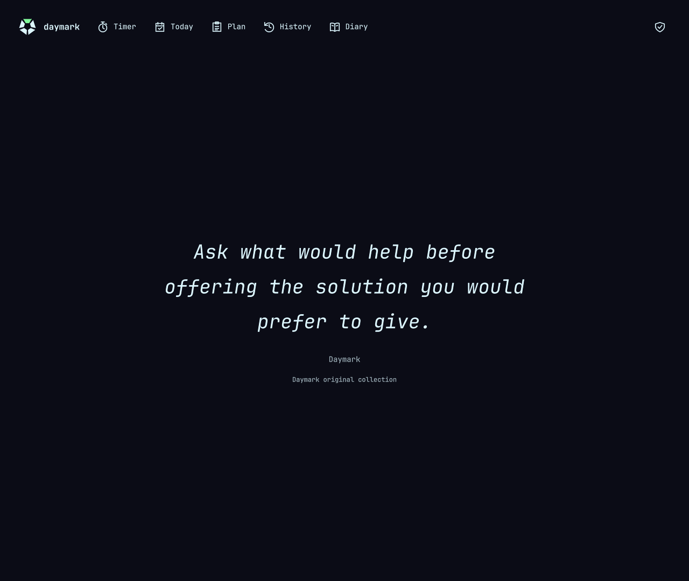
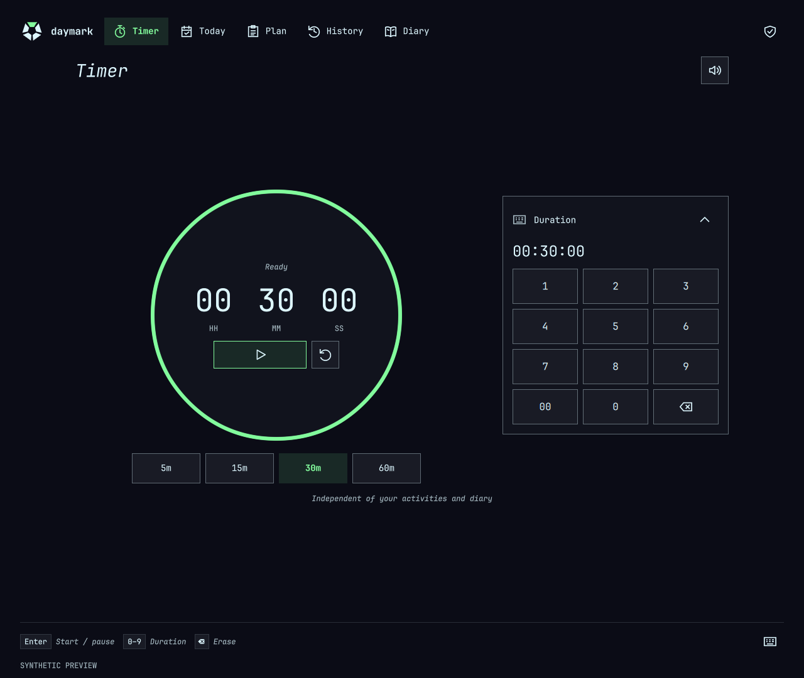
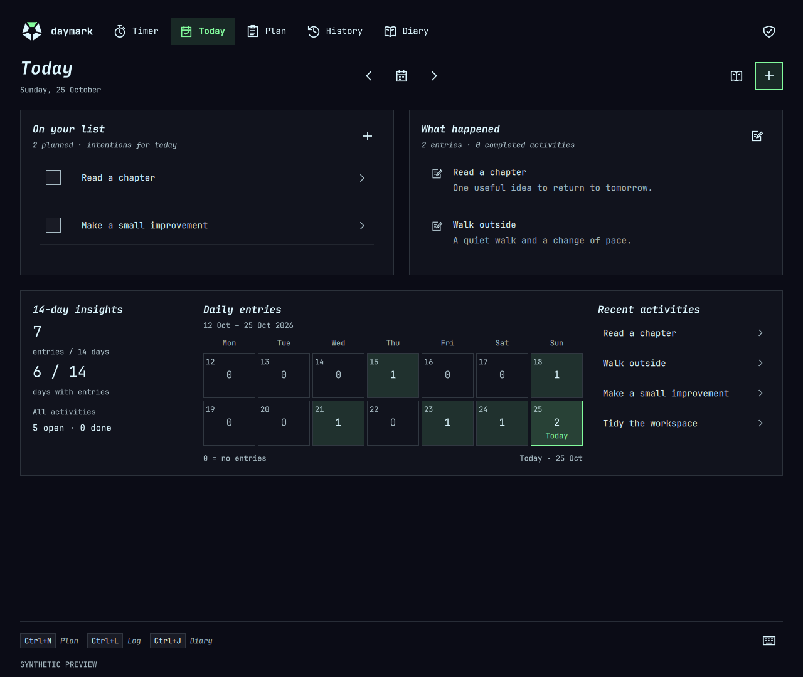
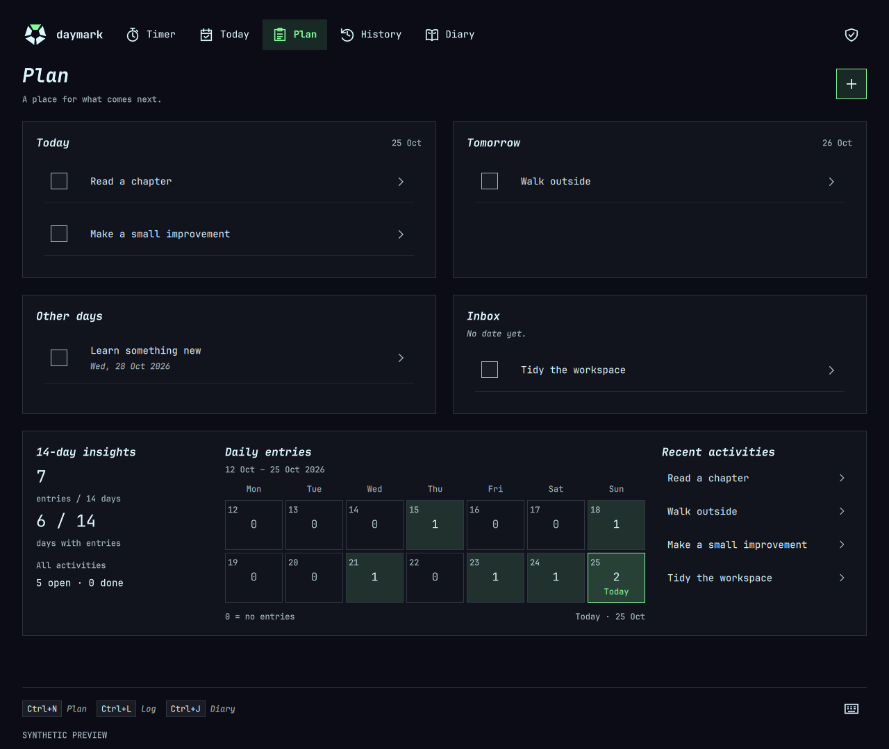
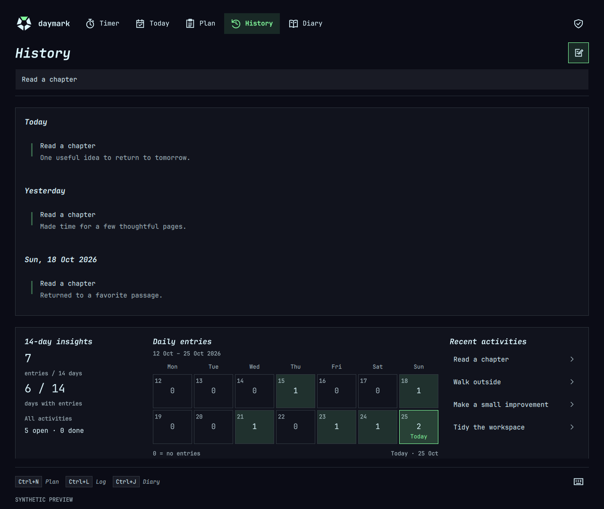
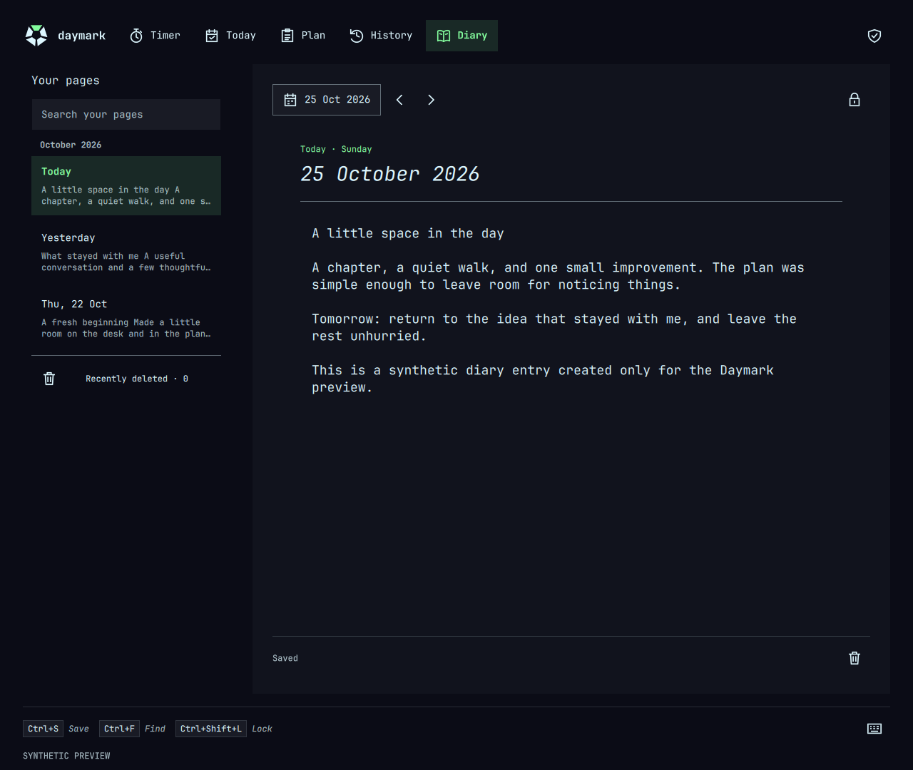

<p align="center">
  <picture>
    <source media="(prefers-color-scheme: dark)" srcset="assets/readme/banner-dark.png">
    <source media="(prefers-color-scheme: light)" srcset="assets/readme/banner-light.png">
    
  </picture>
</p>

<p align="center"><strong>Plan a little. Make time. Keep what matters.</strong><br>A local-first planner, timer and diary for the native Omarchy shell.</p>

- **Plan & log:** Today, Plan and searchable History; reusable activity tasks, selected tasks and optional free-form entries. Logging never implicitly completes an activity.
- **Focus:** a circular countdown with 5 / 15 / 30 / 60-minute presets, clickable hours/minutes/seconds, pause/resume and a gentle chime. Optionally link an activity/task; log explicitly when finished.
- **Reflect:** a system-password-locked Diary, plus a clean quote page behind the logo/name with 1,000 original offline quotes—from thoughtful observations to developer and everyday humor.
- **Settings:** choose the opening page, Timer sound, online quotes and optional Diary idle lock; keep Data & Safety and release checks in one compact dialog.
- **Calendar:** an optional read-only Google Calendar feed, with dated events in Today and Plan—never automatic journal entries.

## Preview

<table>
  <tr>
    <td align="center"><a href="assets/readme/quotes.png"></a><br><strong>Quotes</strong></td>
    <td align="center"><a href="assets/readme/timer.png"></a><br><strong>Timer</strong></td>
  </tr>
  <tr>
    <td align="center"><a href="assets/readme/today.png"></a><br><strong>Today</strong></td>
    <td align="center"><a href="assets/readme/plan.png"></a><br><strong>Plan</strong></td>
  </tr>
  <tr>
    <td align="center"><a href="assets/readme/history.png"></a><br><strong>History</strong></td>
    <td align="center"><a href="assets/readme/diary.png"></a><br><strong>Diary</strong></td>
  </tr>
</table>

Native Qt previews from **v0.2.0** with synthetic data, not mockups or installed-shell screenshots. Click an image to enlarge.

## Install

```bash
omarchy plugin add https://github.com/naolselemon/daymark.git
```

Review the source and the CLI's trust/enable prompts: plugins run **unsandboxed inside your desktop shell**. Open Daymark from its ring icon in the bar. Hover or focus icons for their purpose; **Ctrl+/** shows shortcuts.

Requires the native Omarchy bar/service contract, Quickshell with PAM and Wayland IdleMonitor, Qt Quick/Controls/Dialogs and Python 3 with SQLite. Qt Multimedia is optional for the chime. Observed environment: Omarchy **4.5.0rc2**, Quickshell **0.3.2.r7.g2b4501a**, Qt **6.12.0**, Python **3.14.8** on Linux x86-64—not a compatibility guarantee for other versions or replacement bars.

Open **Settings** with the gear or **Ctrl+,**. Choose Timer, Today or Last used; the sound setting is shared with Timer. Diary idle lock is Off / 1 / 5 / 15 minutes and never disables the existing focus, hide and navigation locks.

<details>
<summary>Optional Google Calendar setup</summary>

Install the feed parsers in a separate user-owned environment, not system Python:

```bash
runtime="${XDG_DATA_HOME:-$HOME/.local/share}/daylog-calendar-runtime"
python -m venv "$runtime"
"$runtime/bin/python" -m pip install -r \
  "${XDG_CONFIG_HOME:-$HOME/.config}/omarchy/plugins/naolselemon.daymark/requirements-calendar.txt"
```

Then open **Settings → Calendars** and paste the calendar's **Secret address in iCal format** from Google Calendar's **Settings → Integrate calendar**. [Google's instructions](https://support.google.com/calendar/answer/37111?hl=en). No OAuth client or API key is needed; **treat the feed address like a password**.

One feed is supported. Refresh runs hourly while enabled, with a manual Refresh button and cached events when offline. Dates span 30 days before to 90 days after the selected day; timed events use the local timezone. Recurring, moved, canceled, all-day and multiday events are handled. Google feed changes may not appear immediately.

The private address and cache stay in owner-only `calendar.sqlite3`, outside activity/diary exports. They are not encrypted; filesystem and updater backups can contain them. Disconnect clears the active cache, not old backups. Google receives ordinary connection metadata, never journal content. Calendars cannot edit Google events or mark activities complete. Other Daymark features work without these optional packages.

</details>

## Your data

- Records stay in `$XDG_DATA_HOME/daylog`, or `~/.local/share/daylog`. No accounts, telemetry or application monitoring.
- **Settings → Data & Safety** exports activities and diary separately. Activity exports include task definitions and historical selections but no diary content; diary exports and all imports require a fresh system-password check. Export both scopes for a complete journal backup.
- **The Diary lock is an interface privacy boundary, not encryption.** SQLite files and JSON backups are plaintext; protect your account and backup files.
- Opening Quotes may contact the free, keyless [ZenQuotes API](https://docs.zenquotes.io/zenquotes-documentation/). No journal content is sent; the provider can see ordinary connection metadata such as your IP address. Turn **Online quotes** off to cancel requests, clear the provider cache and use only the 1,000 bundled originals.
- Countdown completion never automatically logs or completes an activity. Its **Log entry** action saves an untimed entry; acknowledged saves are deduplicated across retries/restarts. After reboot, resume only with your confirmation. Daymark is not an alarm service while disabled.

## Update or remove

**Settings → Check & update** checks GitHub's latest stable release, not an arbitrary branch. Opt-in automatic checks run every 24 hours while the plugin is enabled, with one catch-up after downtime. They are off by default. GitHub receives ordinary connection metadata, never journal content.

Installing an update always asks before restarting the **whole desktop shell**. Save drafts and finish or cancel the countdown first. The updater requires a clean official Git installation, Git and the native systemd user session. It retains private backups, stops the shell before replacing code, preserves bar placement and checks Daymark's actual runtime readiness.

Development previews, manual copies and unsupported layouts cannot self-update. Failed recovery is reported explicitly; code is not rolled back against potentially migrated data. This branch's update/recovery checks use isolated fixtures, not a newly certified production upgrade.

Remove installed code with `omarchy plugin remove naolselemon.daymark`. Updates, disabling and removal preserve the external data directory. **Never delete it as part of an update.**

<details>
<summary>Development and verification</summary>

```bash
python -m venv .venv
.venv/bin/python -m pip install -r requirements-calendar.txt
PYTHONDONTWRITEBYTECODE=1 .venv/bin/python -W error::ResourceWarning -m unittest discover -s tests -v
QT_QPA_PLATFORM=offscreen QML_DISABLE_DISK_CACHE=1 /usr/lib/qt6/bin/qmltestrunner -input tests
omarchy plugin validate .
.venv/bin/python tools/preview.py --demo --scenario settings
```

The disposable preview additionally needs a C++ compiler, `pkg-config` and Qt development tools. It cannot load Quickshell's PAM module: Diary unlock, diary exports and imports remain locked; activity exports still work. Its idle adapter observes preview input, not compositor-wide activity. Self-updating is disabled in previews; these tests are not installed-PAM or upgrade certification.

</details>

**[MIT](LICENSE)** · [Naol Selemon](https://github.com/naolselemon) · [Releases](https://github.com/naolselemon/daymark/releases)

The logo and bundled reflections are original Daymark work. Live quotations retain the linked ZenQuotes attribution; third-party quotations and Omarchy/Quickshell/Qt retain their own rights and licenses.
Optional calendar parsing uses separately installed `icalendar` (BSD-2-Clause) and `recurring-ical-events` (LGPL-3.0-or-later), with their own dependencies and licenses.
